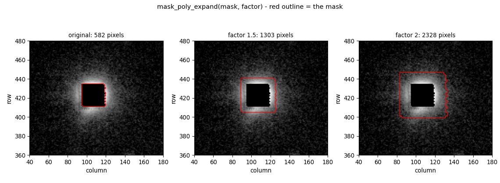

# astro-mask-tools

Two functions for pixel masks in astronomical images:

| function | what it does |
|---|---|
| **`mask_poly_expand(mask, factor)`** | grow or shrink every region of a mask |
| **`mask_manual(image, mask=...)`** | trace regions with the mouse and get a mask back |

Both speak one data type: a 2-D boolean array where `True` means "this pixel is
masked". Feed them the output of your own thresholding, and hand their output
straight to photutils or to your own summation.

```python
from masktools import mask_manual, mask_poly_expand

big = mask_poly_expand(mask, 2.0)     # twice as wide -> four times the pixels
new = mask_manual(image, mask=mask)   # refine it by hand, in a window
```



---

## Install

```bash
pip install -e '.[fits,notebook]'
```

| extra | what it buys |
|---|---|
| *(none)* | `numpy`, `shapely`, `rasterio`, `matplotlib` — enough for both functions |
| `fits` | `astropy`, to read the demo frame and save a mask with its WCS |
| `notebook` | `ipympl` + `ipython`, for the interactive inline plots in the demo |
| `test` | `pytest` + `astropy` |

Python ≥ 3.10. The drawing window is a plain Tk window, which ships with Python
on macOS and Windows (`sudo apt install python3-tk` on Debian/Ubuntu). Nothing is
downloaded at runtime; the demo frame ships in `data/example_cutout.fits.gz`
(820 KB).

---

## Expanding a mask

`factor` is a **linear** factor, like a photocopy enlargement, so the pixel count
goes as `factor**2`. On a 10 × 10 square (100 pixels):

| factor | pixels |
|---|---|
| 0.5 | 25 |
| 1.0 | 100 — the same mask back, bit for bit |
| 1.5 | 225 |
| 2.0 | 400 |
| 3.0 | 900 |

Each region is resized about **its own** centre, so separate regions keep their
separation and nothing slides toward the middle of the frame. On the demo frame's
582-pixel mask (the flagged core of one star): 149 px at 0.5, 1303 px at 1.5,
2328 px at 2.0.

Two things worth knowing:

- A mask cannot grow past the edge of the array. You get a `UserWarning` and the
  overflowing part is dropped; `numpy.pad` the frame first if you need that room.
- Shrinking has a floor. A region whose centre lands on a pixel centre can never
  lose its last pixel, so `factor=0.01` on a 3 × 3 square still leaves 1 pixel.

**How to choose the factor.** "Big enough" is a property of the source, not of the
mask, so measure it rather than eyeball the outline. The demo notebook's *"Was that
worth it?"* cell does exactly that on the demo frame: the flagged core catches 0%
of the star's light at `factor=1`, 96% at 2.0, and all of it at 3.0.

---

## Drawing a mask by hand

`mask_manual` opens a window on the image, waits for you to trace polygons, and
returns the mask when you press `q`. It behaves the same from a Jupyter notebook,
a Qt console, or a script: the call blocks, and it never changes your matplotlib
backend or your `%matplotlib` magic. The window runs in a process of its own, so
a stalled window can never take the notebook kernel with it.

It **returns** the mask; it writes nothing to disk by itself. Save the array
yourself, or pass `savepath="mask.fits"` and press `s` in the window.

| key / gesture | action |
|---|---|
| left click | place a vertex |
| click the first vertex again | close the polygon (needs ≥ 3 vertices) |
| drag a vertex | move it |
| `shift` + drag | move a whole polygon |
| right click a vertex | delete it |
| `n` | finish this region, start the next |
| `d` | delete the last finished region |
| `q` | **done** — return the mask |
| `h` | print this list |

Pass an existing `mask` and its regions arrive as editable outlines, so you are
refining rather than restarting — and you can drag, delete and add to them.
Closing the window without drawing loses nothing: you get the mask you passed in
(or an all-`False` one if you passed none).

```python
mask_manual(image)                       # from scratch
mask_manual(image, mask=auto_mask)       # add to what thresholding found
mask_manual(image, mask=auto_mask, cmap='inferno')   # tune the background
```

---

## The demo notebook

[examples/masktools_demo.ipynb](examples/masktools_demo.ipynb) is the whole
package in 20 cells on a real 512 × 512 EFOSC2 cutout: the frame and its shipped
mask, expanding by a factor on a square where the arithmetic is checkable,
measuring how much starlight each factor actually covers, drawing by hand,
combining the two, and saving the result as FITS with the WCS intact.

---

## Tests

```bash
PYTHONPATH=src python -m pytest tests/ -q
```

266 passed. The suite drives the drawing widget with synthetic mouse and keyboard
events, so the interactive path is covered without opening a window, and
`tests/test_readme_claims.py` re-executes every number quoted above.

---

## Licence

MIT — see [LICENSE](LICENSE).
