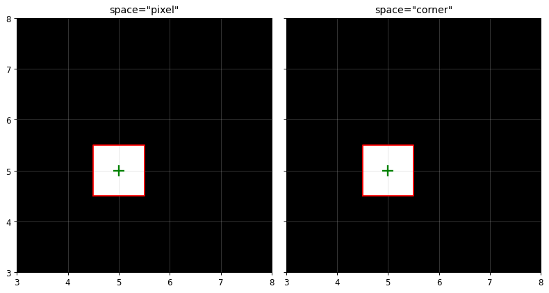
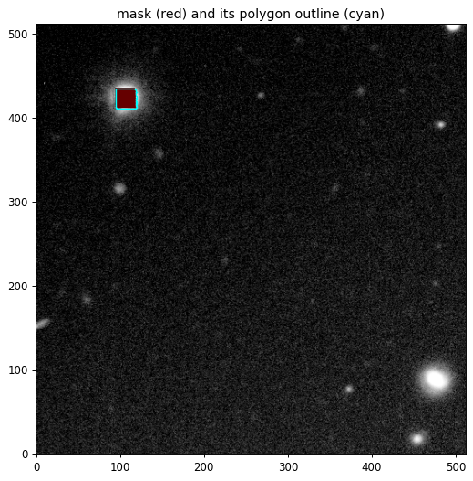
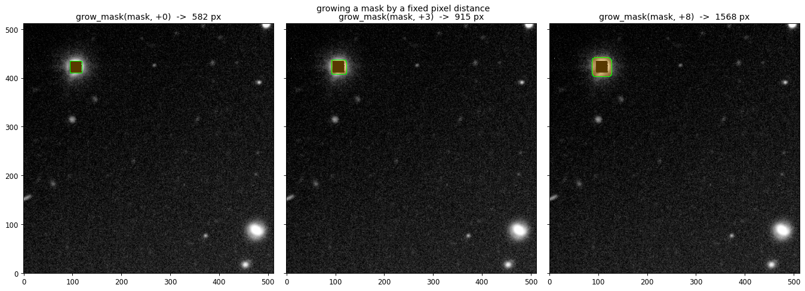
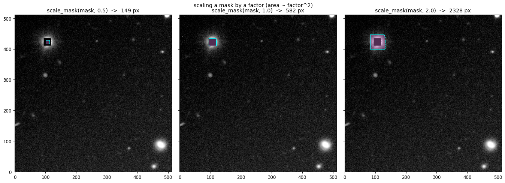
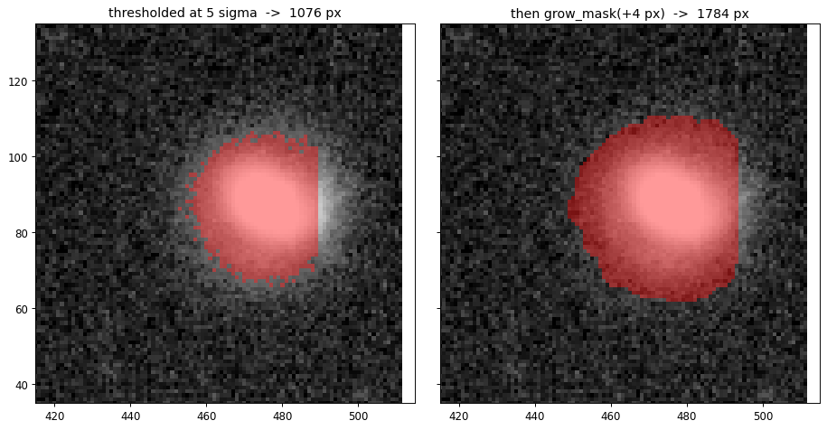
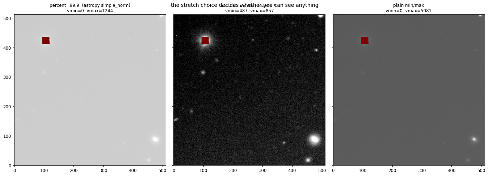

# astro-mask-tools

Small, dependency-light tools for astronomical image masks:

1. **Convert a pixel mask to polygons and manipulate them** — vectorise, grow or
   shrink by a pixel distance, scale by a factor, rasterise back.
2. **Draw polygons by hand** — interactively, in a Jupyter notebook widget or in
   a popup window, and get a mask out.

Built on `shapely` + `rasterio` for the geometry and `matplotlib` for drawing.
It is a stand-alone extraction of what `pixsed`'s `utils.get_mask_polygons` /
`scale_mask` / `MaskBuilder_draw` were doing, with the coordinate handling made
explicit and the interactive part rebuilt on matplotlib's own
`PolygonSelector`. See [Differences from pixsed](#differences-from-pixsed).

```python
import masktools as mt

polys = mt.mask_to_polygons(mask)          # a jagged island -> shapely Polygons
grown = mt.grow_mask(mask, 4)              # ...and back, widened by 4 pixels
drawn = mt.draw_mask(data=image)           # or trace one yourself
```

---

## Install

```bash
pip install -e '.[fits,notebook]'
```

| extra | what it buys |
|---|---|
| *(none)* | `numpy`, `shapely`, `rasterio`, `matplotlib` — everything but FITS and notebooks |
| `fits` | `astropy`, for reading/writing FITS masks and carrying a WCS |
| `notebook` | `ipympl` + `ipython`, for the inline interactive widget |
| `test` | `pytest` + `astropy` |

Python ≥ 3.10. Nothing is downloaded at runtime; the demo frame ships in
`data/example_cutout.fits.gz` (820 KB).

---

## The one thing to read before using this

**Where does a pixel's coordinate point?** Two conventions are in common use and
they differ by half a pixel:

| `space=` | convention | integer `(col, row)` lands on | used by |
|---|---|---|---|
| `"pixel"` **(default)** | array / matplotlib / astropy | the pixel **centre** | `imshow(origin="lower")`, `WCS.pixel_to_world` |
| `"corner"` | rasterio / GDAL | the pixel's **lower-left corner** | `rasterio.features.shapes`, `rasterize`, GeoTIFFs |

A single masked pixel at `[row, col] = [5, 5]` is:

```python
mt.mask_to_polygons(m, space="pixel")[0].bounds    # (4.5, 4.5, 5.5, 5.5)
mt.mask_to_polygons(m, space="corner")[0].bounds   # (5.0, 5.0, 6.0, 6.0)
```



Every function takes `space=`, defaults to `"pixel"`, and translates exactly once
on the way in and once on the way out — so a round trip cannot accumulate a
shift. On the shipped frame (0.2411″/px) the difference is **0.12″**, enough to
matter for a small aperture:

```python
polys = mt.mask_to_polygons(mask, space="pixel")   # overlay-ready
wcs.pixel_to_world(polys[0].centroid.x, polys[0].centroid.y)   # no correction
```

If you mix the two, nothing warns you — the outline is just half a pixel off.
Pass `space="corner"` on **both** ends when you want rasterio's grid.

---

## Feature 1 — vectorise, grow, scale

```python
import numpy as np
from astropy.io import fits
import masktools as mt

image = np.asarray(fits.getdata("data/example_cutout.fits.gz"), float)
mask  = np.asarray(fits.getdata("data/example_cutout.fits.gz", ext=1)).astype(bool)

polys = mt.mask_to_polygons(mask)
len(polys)                        # 1
len(polys[0].exterior.coords)     # 33 vertices tracing the pixel staircase
polys[0].area                     # 582.0 -- exactly the pixel count
polys[0].centroid                 # (106.67, 422.47), pixel space
```



### Grow or shrink by a pixel distance

`distance` offsets the outline along its normal, so the margin is the same
however big the region is. Negative shrinks. This is what you want for "clear the
neighbouring star by 4 pixels".

```python
mt.grow_mask(mask, -1)     #  482 px
mt.grow_mask(mask,  0)     #  582 px
mt.grow_mask(mask,  1)     #  693 px
mt.grow_mask(mask,  4)     # 1029 px
mt.grow_mask(mask,  8)     # 1568 px  -- rounded corners become visible
```



Regions thinner than `2 * |distance|` vanish on a shrink rather than turning
degenerate, and holes close up as the region grows and reopen as it shrinks.

### Or scale by a factor

Area goes as `factor²`, so this is a **magnification**, not a widening — the
effect grows with the source.

```python
mt.scale_mask(mask, 0.5)   #  149 px
mt.scale_mask(mask, 1.5)   # 1303 px
mt.scale_mask(mask, 3.0)   # 5238 px
```



`scale_*` defaults to `origin="centroid"`, which keeps the region put. Pass
`origin="center"` for shapely's bounding-box centre, or `origin=(x, y)` for an
explicit pivot. On an L-shaped region, factor 2 drifts **6.18 px (1.49″ on this
frame)** about the bbox centre and **0.0** about the centroid:

```python
mt.scale_polygons(polys, 2.0, origin="centroid")[0].centroid   # unchanged
mt.scale_polygons(polys, 2.0, origin="center")[0].centroid     # 6.18 px away
```

Use `xfactor` / `yfactor` for anisotropic scaling.

### Threshold → mask → grown mask

No segmentation package needed:

```python
bkg   = np.median(image)                                    # 494.2
sigma = 1.4826 * np.median(np.abs(image - bkg))             # 7.46
star  = np.zeros_like(image, bool)
star[60:110, 440:490] = image[60:110, 440:490] > bkg + 5 * sigma   # 1076 px
grown = mt.grow_mask(star, 4)
```



### Round trip

```python
back = mt.polygons_to_mask(mt.mask_to_polygons(mask), image.shape)
np.array_equal(back, mask)     # True -- exact, holes included
```

`mask_to_polygons` returns one `shapely.Polygon` per connected region, largest
area first, interior rings preserved (a donut round-trips as a donut).
`connectivity=4` joins edge-touching pixels only; `min_area` drops specks;
`fill_holes=True` keeps just the outer shell.

---

## Feature 2 — draw polygons by hand

### In a notebook

```python
%matplotlib widget
import masktools as mt

drawer = mt.MaskDrawer(data=image)   # or mask=existing_mask to refine it
drawer.show()                        # live inline; press q when done
mask = drawer.mask()
```

| gesture / key | effect |
|---|---|
| left click | place a vertex |
| move onto the first vertex, click | close the polygon |
| `n` | finish this polygon, start the next |
| `e` | re-open the last polygon and edit it |
| `d` / Backspace | delete the last polygon |
| right-click a vertex | remove that vertex |
| drag a vertex | move it |
| `Ctrl` + drag | move one vertex (the widget's own binding) |
| `Shift` + drag | move the whole polygon (the widget's own binding) |
| `Esc` | clear the polygon in progress |
| `s` | save to `savepath` |
| `q` / `c` | finish and close |
| `h` | print this table |

Finished polygons and the one still being drawn are kept apart, but `.vertices`
and `.mask()` see both — check your progress mid-stroke without committing:

```python
drawer.vertices       # list of (N, 2) arrays, pixel space
drawer.polygons       # the same as shapely Polygons
drawer.mask()         # rasterised bool array
drawer.save("mask.fits", header=image_header)   # the WCS travels with it
```

Refining an existing mask is the other main use — pass it in and it arrives as
editable polygons rather than as a picture to trace over:

```python
drawer = mt.MaskDrawer(data=image, mask=threshold_mask)
drawer.delete_last()          # drop the smallest stray component
drawer.add_polygon([(455, 75), (475, 75), (475, 95), (455, 95)])
refined = drawer.mask()
```

`add_polygon` also builds a mask from coordinates with no mouse at all, which is
what the examples use so they stay runnable headless.

### From a script, in a popup

Same class; `show()` blocks on a real window backend.

```bash
python examples/03_popup_draw.py                       # the shipped cutout
python examples/03_popup_draw.py my_frame.fits -o m.fits
python examples/03_popup_draw.py --shape 512,512       # blank canvas
python examples/03_popup_draw.py --demo                # headless self-check
```

### One-liner

```python
mask = mt.draw_mask(data=image)                 # blocks, returns the array
drawer = mt.draw_mask(data=image, block=False)  # returns the drawer to poll
```

`MaskDrawer` works without any image at all (`shape=(nrow, ncol)` gives a blank
canvas). Vertices are always in pixel space, so what you draw lines up with
`imshow(origin="lower")` and feeds `WCS.pixel_to_world` directly.

---

## Plotting

```python
ax = mt.plot_image(image)                       # asinh, clipped 16th-99.9th pct
mt.plot_mask(mask, ax=ax, color="red", alpha=0.35)
mt.plot_mask_contours(mask, ax=ax, edgecolor="cyan")
mt.plot_polygons(polys, ax=ax)                  # holes drawn dashed
fig = mt.show_mask(mask, data=image)            # side-by-side panels
```

`plot_image`'s default stretch is `asinh` clipped at the **16th and 99.9th
percentiles** — asymmetric on purpose. Astropy's `simple_norm(percent=99.9)`
clips *symmetrically*, and this frame contains 582 exactly-zero pixels (0.22% of
it) inside the saturated star, so the symmetric low cut lands on them: `vmin`
goes from 487 to **0** against a sky of 494, and the whole image flattens grey.

| rule | vmin | vmax | result |
|---|---|---|---|
| `percent=99.9` (astropy `simple_norm`) | 0.0 | 1244.2 | washed out |
| **default** `min_percent=16, max_percent=99.9` | 486.8 | 856.9 | readable |
| `min_percent=None, max_percent=None` | 0.0 | 5081.5 | plain min/max |



`percent=99.9` is still accepted and reproduces astropy **exactly** — the asinh
curve agrees term for term to 1e-9 — for when you need a pixel-for-pixel match
with an existing notebook. Precedence: explicit `vmin`/`vmax` > `percent` >
`min_percent`/`max_percent`.

The asinh stretch is built with `FuncNorm` rather than matplotlib's `AsinhNorm`,
because `AsinhNorm` only exists on matplotlib ≥ 3.8, is documented as provisional,
and in 3.10 ignores its own `linear_width` argument — so it cannot express
astropy's `asinh_a` at all.

---

## Caveats, all measured rather than assumed

These follow from doing the arithmetic in the vector domain and then rasterising.
They are documented here because each one is surprising the first time it bites.

**1. Rasterisation is quantised by up to half the perimeter.** `rasterize` counts
a pixel when its *centre* falls inside, so `|vector area − pixel count|` is
bounded by about `perimeter / 2` — a limit on the **outline length**, not on the
area, which is why it is proportionally worst on small or ragged regions. The
observed supremum of that ratio is 1.05. The sign is **not** fixed: it flips as
`distance` sweeps past a ring of pixel centres, and is worst just below each
half-integer (`distance=0.49` on a 100×100 box puts the vector area 197 px above
the count, against a 202 px bound).

**2. `distance < 0.5` changes nothing.** Pixel centres are 1 apart, so a
sub-half-pixel buffer cannot reach a new one — then it jumps by a whole ring:

```python
box = np.zeros((200, 200), bool); box[50:150, 50:150] = True   # 10000 px
mt.grow_mask(box, 0.49).sum()    # 10000  -- unchanged, silently
mt.grow_mask(box, 0.50).sum()    # 10200  -- a full ring (10201 with join_style="mitre")
```

Use `distance >= 1` for a guaranteed ring, or `all_touched=True` to be inclusive.

**3. `join_style="mitre"` is exact only on the half-pixel lattice, and only
there.** At multiples of 0.5 a buffered **solid, isolated** rectilinear outline
passes through pixel centres, so the count equals the vector area to machine
precision. Two things break it, and both are worth recognising in your own
numbers:

* a surviving **hole** moves against the centres, so the raster comes out
  *larger* than the vector area at half-integer distances (sign inverted);
* `grow_polygons` buffers each region on its own while the mask is their
  **union**, so neighbours the buffer pushes into overlap get double-counted by
  `sum(p.area for p in polys)`. Call `shapely.unary_union` first if you need
  that comparison to mean anything.

**4. Grow then shrink is a smoothing, not an inverse.** `buffer(+d)` then
`buffer(−d)` is a morphological opening: it erases anything thinner than `2*d`
and cannot restore corners.

```python
mt.grow_mask(mt.grow_mask(box, 3), -3)      # exact: integer d, boxy shape
mt.grow_mask(mt.grow_mask(mask, 3), -3)     # 582 -> 593 px, IoU 0.981
mt.grow_mask(mt.grow_mask(mask, 2.5), -2.5) # 582 -> 568 px, IoU 0.876
```

Exact round-tripping needs *both* an integer `d` *and* a boxy outline; the
shipped staircase fails even at `d = 3`. Never grow a mask "temporarily" and
expect it back — keep the original array.

**5. `out_shape` only buys room toward higher indices.** Rasterising into a
larger grid extends the frame at the top/right, so a region tucked at `[0, 0]`
cannot grow into negative coordinates. This is warned about, not silent:

```
UserWarning: the transformed mask extends outside the 16x16 output grid
(x: -3.0..18.0, y: -3.0..18.0), so those pixels are dropped. Enlarge
out_shape to grow toward higher row/column, or pad the input mask
(numpy.pad) when the region touches the low/left edge.
```

**6. Repairing a self-intersecting staircase can split a region.** `rasterio`
occasionally emits a ring that crosses itself on a ragged outline; `buffer(0)`
repairs it, sometimes into a `MultiPolygon`. `mask_to_polygons` flattens that, so
you always get `Polygon`s with a working `.exterior`/`.interiors` — but one
region may come back as several. The shipped frame's 5σ threshold mask (1076 px)
yields 13 polygons: a 1063-px body plus twelve 1–2-px slivers. Areas still sum to
the pixel count and the round trip stays exact; `min_area=5` keeps just the body.

**7. This is not `scipy.ndimage.binary_dilation`.** Dilation works on the pixel
grid with a structuring element, preserves square corners, and adds exactly the
footprint. A vector buffer rounds corners and moves by a true Euclidean distance.

---

## API

| group | functions |
|---|---|
| **vectorise** | `mask_to_polygons`, `polygons_to_mask`, `mask_area` |
| **transform** | `scale_polygons`, `grow_polygons`, `scale_mask`, `grow_mask` |
| **draw** | `MaskDrawer`, `draw_mask` |
| **plot** | `plot_image`, `plot_mask`, `plot_polygons`, `plot_mask_contours`, `show_mask`, `make_norm` |
| **coordinates** | `SPACES`, `pixel_to_corner`, `corner_to_pixel` |

Polygon-taking functions accept a `shapely.Polygon`/`MultiPolygon`, a GeoJSON
dict, anything with `__geo_interface__`, an `(N, 2)` array, or a list of those.
Mask-taking functions accept `bool`, `uint8`, `int`, or a labeled segmentation map
(every label becomes part of one boolean region).

---

## Examples and data

| file | what it shows |
|---|---|
| [`examples/01_vectorize_and_transform.py`](examples/01_vectorize_and_transform.py) | the whole non-interactive API on the real frame; writes `examples/figures/*.png` |
| [`examples/02_draw_interactive.ipynb`](examples/02_draw_interactive.ipynb) | the drawing workflow, cell by cell |
| [`examples/03_popup_draw.py`](examples/03_popup_draw.py) | the popup path, including `--demo` |
| [`examples/build_notebook.py`](examples/build_notebook.py) | regenerates the notebook (generated, not hand-edited, so it stays reviewable in diffs) |

The data file is a 512×512 cutout of an EFOSC2 g-band frame of `J0000-0541`,
cropped from a reprojected stack, with the original WCS shifted onto the new
reference pixel (round-trip error against the source file: 0.000e+00 arcsec). The
primary HDU is the science image; extension `MASK` is a uint8 segmentation of the
saturated star, 582 pixels.

The notebook is committed **without outputs** (25 KB). To check it still runs:

```bash
python examples/build_notebook.py --verify
```

That executes a throwaway copy and reports errors, leaving the tracked file
clean. Do not run `nbconvert --inplace` on it: `ipympl` dumps ~3.5 MB of widget
state into `metadata.widgets`.

---

## Tests

```bash
pip install pytest --target .testdeps        # gitignored local runner
PYTHONPATH=src:.testdeps python3 -m pytest tests/
# 202 passed
```

The suite covers the half-pixel contract with a single-pixel canary, exact mask
round trips, hole survival, the quantisation laws above, and the whole
interactive path — every `MaskDrawer` gesture is driven by synthetic canvas
events on the `Agg` backend, so the widget wiring is tested without opening a
window.

`tests/test_readme_claims.py` re-executes the ~40 numbers quoted in this file,
which is why they can be trusted: three of them were wrong in the first draft
(each a figure carried over from a different shape or a different `join_style`),
and several of the caveats in the section above were written down backwards and
corrected by measurement. `tests/check_readme_links.py` checks that every path
and table in this file still resolves.

---

## Differences from pixsed

`pixsed.utils` already did most of this. What changed:

| | pixsed | masktools |
|---|---|---|
| vectorise | `get_mask_polygons` returns GeoJSON **dicts** via `np.array(list(shapes(...)))`, so every caller writes `shape(p)` itself | returns `shapely.Polygon`s, sorted largest first, invalid rings repaired and flattened |
| coordinates | corner space, undocumented — a pixel at `[5,5]` gives bounds `(5,5,6,6)`, and `plot_mask_contours` subtracts 0.5 by hand to compensate | explicit `space=` on every function defaulting to `"pixel"`; translate once in and once out, so nothing compensates by hand |
| scaling | `scale(shape(p), xfact, yfact)` — shapely's default bbox-centre origin, so an L-shape at factor 2 drifts 6.18 px (1.49″ here) | `origin="centroid"` by default: 0.0 drift, with `"center"` and an explicit pivot still available |
| growing | absent (`simplify_mask` is a convex hull) | `grow_mask`/`grow_polygons` with `join_style`, `quad_segs`, `min_area` |
| drawing | `MaskBuilder_draw` collects vertices on `shift` + left click and maintains its own artist list; `shift` also means "move everything" in matplotlib's widget vocabulary, and the discard path is an unfinished `FIXME` | built on `matplotlib.widgets.PolygonSelector`, so the standard gestures keep working; committed/live separation, `e` to re-edit, and no rebinding of `escape`/`shift`/`control` |
| notebook coupling | calls `get_ipython().run_line_magic("%matplotlib tk")` from library code, changing the user's backend | never touches the `%matplotlib` magic; warns clearly when the backend cannot show a window |
| `on_close` | the WCS branch is inverted (`header = wcs.to_header()` guarded by `if wcs is None`) | `save(header=...)` — attaching the frame's header is your one-line choice, and it is exercised in the tests |
| errors | silent: an empty mask, a bad connectivity, a non-2-D array each fail differently | validated with messages naming the bad argument; clipping is a `UserWarning` rather than lost pixels |

The measured caveats above come from this package's own tests. Several were
written down wrongly in an earlier draft of this file and corrected by running
the numbers, which is the reason they are stated with their measurements.

## License

MIT — see [LICENSE](LICENSE).
